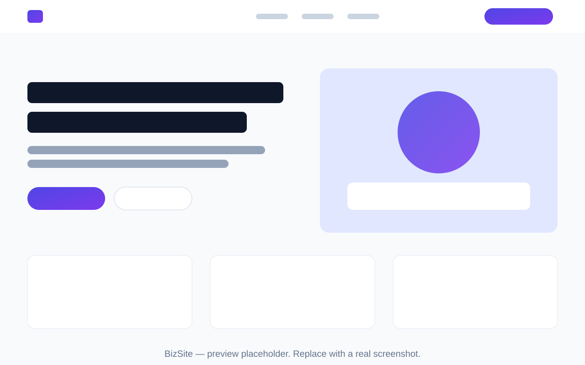

# BizSite — Premium HTML/CSS Business Website Template

A modern, responsive, dependency-free business website template built with
**plain HTML5, CSS3 and a small amount of vanilla JavaScript**. No
frameworks, no libraries, no CDN links, no build step — just open
`index.html` and it works.

BizSite ships with a complete fictional agency website ("NovaEdge
Solutions") so you can see every section in context, then replace the
content with your own.



> The preview above is a placeholder illustration. After you set the
> template up, replace `assets/images/preview.svg` with real screenshots
> of your site (recommended size: 1280 × 800).

---

## Features

- **4 complete pages** — Home, About, Services and Contact, sharing one
  header, footer, stylesheet and script.
- **Premium agency design** — clean SaaS-style layout, gradient accents,
  soft shadows, generous whitespace and smooth hover states.
- **Dark / light mode** — one-click toggle, preference saved in
  `localStorage`.
- **Fully responsive** — mobile, tablet and desktop layouts with a
  slide-down mobile navigation menu.
- **Accessible by default** — semantic HTML5 landmarks, skip link,
  labelled forms, `aria` attributes on the menu, slider, accordion and
  counters, visible focus states and `prefers-reduced-motion` support.
- **SEO ready** — per-page titles, meta descriptions, Open Graph and
  Twitter card tags, and an SVG favicon.
- **Small, purposeful JavaScript** — mobile menu, testimonial slider,
  FAQ accordion, animated counters, scroll-reveal animations,
  back-to-top button and form validation. That is all.
- **Easy to customise** — the entire theme (colours, fonts, spacing,
  radii) is controlled by CSS variables in one place.
- **Easy to convert to WordPress** — the structure maps cleanly onto a
  WordPress theme (see the conversion notes below).

## Pages & Sections

### Home (`index.html`)

Top bar (email / phone / socials) · sticky header · hero with animated
stats · trusted-by logo strip · services grid (6) · about split section ·
why-choose-us features (6) · portfolio grid (6) · pricing (3 tiers) ·
testimonial slider · FAQ accordion · blog preview (3) · CTA banner ·
4-column footer with newsletter form.

### About (`about.html`)

Page hero with breadcrumb · company story · values (6) · animated stats
band · team grid (4) · CTA banner.

### Services (`services.html`)

Page hero · six detailed service blocks in alternating layout (each with
deliverables list) · 4-step process · pricing teaser · FAQ · CTA banner.

### Contact (`contact.html`)

Page hero · contact info cards (office, phone, email) · office hours
table · contact form with front-end validation and a success message ·
map placeholder section (styled block — no external embed).

## Tech Stack

| Layer     | Technology                                            |
| --------- | ----------------------------------------------------- |
| Markup    | HTML5 (semantic)                                      |
| Styling   | CSS3 — variables, grid, flexbox, custom properties    |
| Behaviour | Vanilla JavaScript (ES6), one shared file (~11 KB)    |
| Graphics  | Inline SVG icons + local SVG illustrations            |
| Fonts     | System font stack (no web-font downloads)             |

## Installation

There is nothing to install and nothing to build.

**Option 1 — just open it**

Download or clone the project and open `index.html` in any modern
browser.

**Option 2 — clone with Git**

```bash
git clone https://github.com/afzaalahmedofficial3-gif/bizsite-html-business-template.git
cd bizsite-html-business-template
```

**Option 3 — serve it locally** (recommended, so relative paths behave
exactly as they will in production):

```bash
# Python
python3 -m http.server 8000

# or Node
npx serve .
```

Then visit `http://localhost:8000`.

To publish, upload the whole folder to any static host (GitHub Pages,
Netlify, Vercel, cPanel shared hosting, etc.) — no server-side code is
required.

## Customising the Template

### Colours, fonts and spacing

Open `assets/css/style.css` and edit the variables at the top
(section **01. CSS variables**):

```css
:root {
  --color-primary: #4f46e5;      /* main brand colour */
  --color-accent: #7c3aed;       /* gradient partner colour */
  --color-bg: #ffffff;           /* page background */
  --color-text: #0f172a;         /* main text colour */
  --font-sans: -apple-system, BlinkMacSystemFont, "Segoe UI", Roboto, sans-serif;
  --radius: 0.75rem;             /* corner rounding */
  --space-section: 6rem;         /* vertical section padding */
}
```

Dark-mode colours live directly below, under `[data-theme="dark"]` —
change them the same way.

### Replacing the content

- **Company details** — the demo company is "NovaEdge Solutions".
  Search the HTML files for `NovaEdge`, `novaedge.example`,
  `+1 (555) 123-4567` and `123 Business Avenue` and replace them with
  your own details in the top bar, contact page and footer.
- **Logo** — the logo is a styled letter in a gradient box
  (`.logo__mark`). Swap the letter, or replace the whole `.logo` link
  with your own ``.
- **Navigation** — links live in `.nav__list` in each page's header.
  Add or remove `<li>` items; the page you are on uses the
  `nav__link--active` class.
- **Sections** — every section is a self-contained `<section>` block.
  Copy, reorder or delete them freely; cards use the `.grid--2`,
  `.grid--3` and `.grid--4` layout classes.

### Replacing the images

All graphics are local SVG files in `assets/images/` — swap them for
your own photos or illustrations, keeping the same file names, or update
the `src` attributes. Every `` carries descriptive `alt` text;
please keep it accurate for accessibility. Portfolio and blog images are
intentionally simple placeholder designs.

### The contact & newsletter forms

Both forms are **front-end only**: JavaScript validates the input and
shows a success message, but nothing is sent anywhere. To receive real
submissions, point the form at your own backend or a form service
(Formspree, Netlify Forms, your WordPress form plugin, etc.) — set the
form's `action`/`method`, or handle the `submit` event in
`assets/js/script.js` (section 8) and POST the data yourself.

### The map placeholder

The contact page uses a styled placeholder instead of a live map so the
template works fully offline and never loads third-party trackers. To
use a real map, replace the `.map-placeholder` block with your map
provider's embed code.

## Convert to WordPress

BizSite is structured so it can be turned into a WordPress theme with
minimal rework:

1. **Split the chrome** — move everything from the top of a page down to
   `</header>` into `header.php`, and the footer block into
   `footer.php`. Call them with `get_header()` / `get_footer()`.
2. **Enqueue the assets** — register `assets/css/style.css` with
   `wp_enqueue_style()` and `assets/js/script.js` with
   `wp_enqueue_script()` in `functions.php` instead of hard-coding the
   tags.
3. **Make the menu dynamic** — replace the static `.nav__list` markup
   with `wp_nav_menu()`, keeping the same classes via the
   `menu_class` / `link_class` arguments or a small walker.
4. **Page templates** — `index.html`, `about.html`, `services.html` and
   `contact.html` become `front-page.php` / page templates; replace
   headings and text with `the_title()`, `the_content()` or ACF fields.
5. **Reusable sections** — the CTA banner, FAQ and pricing blocks are
   ideal candidates for Gutenberg blocks or ACF flexible-content rows.
6. Keep the CSS variables: they pair nicely with `theme.json` global
   styles if you later move to a block theme.

## Project Structure

```
bizsite-template/
├── index.html                  # Home page
├── about.html                  # About page
├── services.html               # Services page
├── contact.html                # Contact page
├── assets/
│   ├── css/
│   │   └── style.css           # All styles (variables, layout, components)
│   ├── js/
│   │   └── script.js           # All behaviour (menu, slider, FAQ, forms…)
│   └── images/
│       ├── favicon.svg
│       ├── og-image.svg        # Social sharing image
│       ├── preview.svg         # README preview placeholder
│       ├── hero-illustration.svg
│       ├── about-illustration.svg
│       ├── team-1.svg … team-4.svg
│       ├── portfolio-1.svg … portfolio-6.svg
│       └── blog-1.svg … blog-3.svg
├── README.md
├── LICENSE                     # MIT
├── CONTRIBUTING.md
├── CHANGELOG.md
└── .gitignore
```

## Browser Compatibility

BizSite uses evergreen web platform features only (CSS grid, flexbox,
custom properties, `IntersectionObserver`, ES6 JavaScript) and works in
all current browsers:

- Chrome / Edge (last 2 versions)
- Firefox (last 2 versions)
- Safari 15+
- Samsung Internet / Chrome for Android (current)

Internet Explorer is not supported.

## Contributing

Contributions are welcome — please read [CONTRIBUTING.md](CONTRIBUTING.md)
for how to report bugs, propose changes and submit pull requests. The
golden rule: keep the template dependency-free.

## License

Released under the [MIT License](LICENSE). Use it for personal and
commercial projects, modify it, and ship it — attribution is appreciated
but not required.
